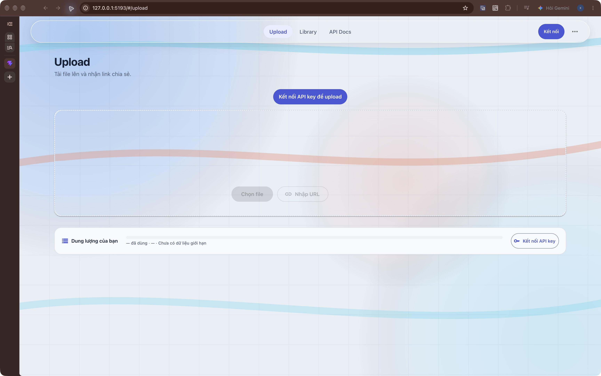
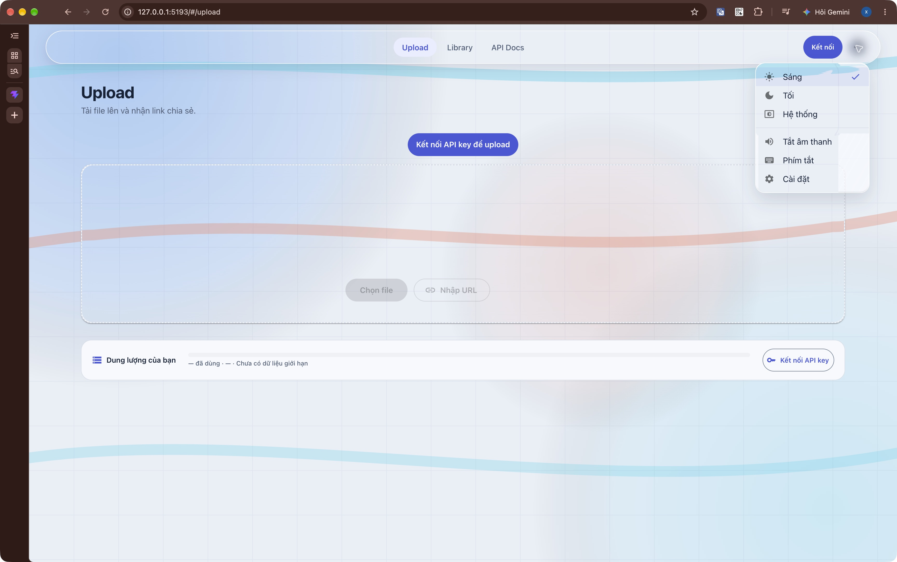

# ImgStore — kế hoạch làm lại Liquid Glass theo ảnh tham chiếu

Ngày lập, rà lại và triển khai: **07/10/2026**. Baseline thiết kế ban đầu: **`505bfcd`**. Source mới nhất: **`dd0d7ee` + working tree**. Phạm vi: toàn bộ frontend `imgstore-web`. Trạng thái: **đã triển khai các sửa runtime trong §18; QA desktop có bằng chứng, chưa đóng toàn bộ browser matrix**.

**Trạng thái mới nhất — §18:** đã sửa lớp kính che foreground, thêm nguồn media độc lập, fallback backdrop thật khi DOM che scene, xử lý readback lỗi và giảm chi phí renderer. Đã kiểm trực tiếp trên Chrome **154.0.8037.59** với dữ liệu local; root check chạy cả frontend tests. **§16–17 giữ nguyên phát hiện lịch sử; không còn là mô tả runtime hiện tại.** Chi tiết thay đổi, số đo và những phần QA còn thiếu ở [báo cáo triển khai](./docs/liquid-glass-v2/IMPLEMENTATION_2026-10-07.md).

**Tài liệu này là nguồn ưu tiên cho lần làm lại.** Nó thay các quyết định về nền, vật liệu, optics, mặc định và nghiệm thu thị giác trong plan cũ. Các sửa lỗi auth, queue, dữ liệu, accessibility và API đã có vẫn giữ. Lượt triển khai §18 thay đổi runtime và gate kiểm tra; không reset các thay đổi khác đang có trong source.

## 1. Mục tiêu và những quyết định phải đổi

Làm ImgStore có cảm giác như một lớp kính cong nổi trên một môi trường có màu và chi tiết: nhìn được nền xuyên qua thân kính; nền bị bẻ cong rõ ở mép; ánh sáng mô tả hình khối; chữ và icon phía trên sắc nét. Hiệu ứng phải nhìn thấy ngay khi mở web trên **Chrome**, không cần vào Settings hoặc bật browser flag.

| Quyết định cũ | Quyết định V2 | Lý do |
| --- | --- | --- |
| CSS blur + tint là bản hoàn chỉnh; SVG lens có cũng được | Khúc xạ có thể quan sát là yêu cầu P0; chọn renderer sau prototype có bằng chứng | Ảnh mẫu cần hiệu ứng thấu kính, không chỉ kính mờ |
| Canvas gần đơn sắc với hai vùng radial rất nhẹ | Có background mặc định chứa vùng sáng/tối, hình khối và chuyển màu đủ rõ | Phải có thứ để nhìn xuyên qua và nhận ra biến dạng |
| Tăng/giảm alpha để giải quyết toàn bộ vẻ ngoài | Tách transmission, scattering, refraction, highlight và readability | Một slider alpha không tạo ra hình khối kính |
| Control kính chỉ xuất hiện ở vài thanh nhỏ | Thiết kế một hệ control rõ ràng, có navbar, toolbar, menu, panel thao tác và preview chrome | Người dùng phải nhận ra ngôn ngữ này xuyên suốt sản phẩm |
| Coi mọi container upload/form/dialog là C0 theo loại component | Phân loại theo vai trò: vỏ panel thao tác có thể là kính; vùng nhập/đọc bên trong dùng fill ổn định | Tránh cả hai cực: toàn trang opaque hoặc mọi thứ xuyên thấu |
| Kiểm tra computed style rồi kết luận hiệu ứng đã rõ | Đối chiếu ảnh và clip có nền chi tiết, test mép kính, sau đó kiểm tra readability/performance | Chất lượng thị giác là một cổng nghiệm thu độc lập |

Không đổi framework, route, tên sản phẩm, API contract hoặc mô hình quyền để phục vụ hiệu ứng. Không dùng ảnh chụp Control Center làm background hay chụp nguyên giao diện thành ảnh. Không yêu cầu người dùng chuyển sang Safari.

## 2. Phân tích bốn ảnh người dùng gửi

Các bản gốc được giữ tại `docs/liquid-glass-v2/references/`, ngoài thư mục public. Chúng là tài liệu tham chiếu nội bộ cho kế hoạch; chưa xác định quyền dùng làm asset phát hành.

| Ảnh | Chi tiết phải học | Điều không suy diễn từ ảnh |
| --- | --- | --- |
| [01 — pane kính dày](./docs/liquid-glass-v2/references/01-thick-optical-pane.png) | Thân kính truyền màu của ảnh; phần giữa mềm; các chi tiết bị kéo/uốn ở mép; viền trên sáng, viền dưới đổi màu theo môi trường; cảm giác kính có tiết diện | Cursor, tay nắm và đường điều chỉnh thuộc công cụ chỉnh ảnh, không phải control ImgStore. Không suy ra ảnh đang chạy realtime |
| [02 — nút tròn và Focus pill](./docs/liquid-glass-v2/references/02-controls-and-focus-pill.png) | Cùng một nền xanh/đỏ nhưng từng nút nhận màu khác nhau theo vị trí; cạnh tròn có lensing; pill phản chiếu rộng hơn; icon/chữ trắng nằm trên mặt kính, không bị blur theo nền | Không xác định nguồn gốc hoặc phiên bản iOS chỉ từ screenshot. Không coi mọi trạng thái đều cần cùng độ trong |
| [03 — pill trên hoa, mẫu PSD](./docs/liquid-glass-v2/references/03-flower-glass-pill-psd.png) | Màu cam/đỏ của hoa xuyên vào kính; mép dài có độ dày; hai đầu pill cong và bắt sáng; màu xanh ở cạnh thuộc môi trường nền | Đây là đồ họa quảng bá PSD, không phải chứng cứ một renderer web/native chạy được. Không bê chữ khổng lồ hay bố cục quảng cáo vào app |
| [04 — các panel Control Center](./docs/liquid-glass-v2/references/04-control-center-panels.png) | Hệ panel và control có chung hình học; background ảnh giàu chi tiết; bề mặt có transmission và rim cong; nội dung phía trên rõ; selected state và slider có fill chủ đích | Không sao chép phần cứng iPhone, Dynamic Island, tên bài hát hay chức năng hệ thống sang ImgStore |

### 2.1. Sáu đặc tính chung tạo nên mục tiêu thị giác

1. **Transmission:** nhận ra màu và cấu trúc nền đang nằm đúng phía sau pane, không phải một gradient khác được dán lên kính.
2. **Refraction/lensing:** một đường, khuôn hình hoặc vùng màu đổi hướng/độ rộng khi đi vào dải mép. Tâm kính ít biến dạng hơn cạnh.
3. **Thickness:** cạnh có một vùng chuyển tiếp đủ rộng, không chỉ một border 1px. Góc và đầu pill thể hiện độ cong rõ nhất.
4. **Reflection/specular:** vùng bắt sáng có hướng và thay đổi theo hình học. Không bao quanh toàn bộ pane bằng một đường trắng đồng đều.
5. **Scattering:** làm mềm nền vừa đủ để tạo chất liệu; không xóa hết cấu trúc màu bằng blur lớn.
6. **Foreground separation:** text, icon, focus, caret và trạng thái tương tác luôn sắc nét, nằm trên renderer vật liệu.

Các hiện tượng trên là **diễn giải từ ảnh và mục tiêu mô phỏng của ImgStore**. Không có dữ liệu để khôi phục chính xác độ dày, chỉ số khúc xạ hoặc shader tạo ra các ảnh này.

### 2.2. Mức ưu tiên của ảnh

- Ảnh 02/04: tham chiếu chính về hệ control, mật độ, hình học và chữ/icon.
- Ảnh 01/03: tham chiếu mạnh về độ dày, transmission và chất lượng mép kính.
- Không lấy độ lòe loẹt của ảnh quảng bá làm mặc định toàn app. Mục tiêu là chất kính rõ nhưng vẫn dùng được để upload, tìm file và đọc tài liệu.

## 3. Đối chiếu tài liệu chính thức và giới hạn của chữ “chuẩn”

### 3.1. Điều đã xác minh

Apple mô tả lensing là cách Liquid Glass thể hiện hình dạng; vật liệu bẻ và tập trung ánh sáng thay vì chỉ tán xạ như vật liệu mờ trước đó. Đây là cơ sở để nâng khúc xạ thành yêu cầu chính của lần làm lại. [Apple — Meet Liquid Glass, WWDC25](https://developer.apple.com/videos/play/wwdc2025/219/)

Tài liệu Materials phân biệt `regular` và `clear`. Không đồng nhất tên variant của ImgStore với implementation native của Apple. [Apple HIG — Materials](https://developer.apple.com/design/human-interface-guidelines/materials)

Apple xác nhận iOS 27 có slider từ ultraclear đến fully tinted; WWDC26 cũng nêu diện mạo cập nhật và sự thích ứng với slider. Điều này **không** có nghĩa người dùng web phải chỉnh slider để có hiệu ứng kính. [Apple Support — What’s new in iOS 27](https://support.apple.com/en-ie/guide/iphone/iphfed2c4091/27/ios/27), [Apple — What’s new in SwiftUI, WWDC26](https://developer.apple.com/videos/play/wwdc2026/269/)

### 3.2. Cách áp dụng vào ImgStore

- Dùng kính cho mặt phẳng điều hướng và thao tác nổi trên nội dung. Giữ hierarchy, tránh chồng nhiều bộ lọc kính lên nhau. [Apple — Meet Liquid Glass](https://developer.apple.com/videos/play/wwdc2025/219/)
- Thiết kế theo ảnh người dùng chọn, không lấy một mức tint cụ thể của iOS làm lý do phủ trắng/xám phần lớn kính.
- Các con số màu, blur, radius, displacement và duration bên dưới là **đề xuất ImgStore để prototype**, không phải bộ token Apple công bố.
- Web không gọi được renderer Liquid Glass của SwiftUI/UIKit chỉ bằng CSS. Mục tiêu là tái tạo các dấu hiệu quang học có thể quan sát; không tuyên bố giống native 100%.
- Không coi tán sắc cầu vồng, độ méo cực mạnh hoặc nền liên tục chuyển động là yêu cầu “chuẩn Apple”. Chỉ dùng nếu làm hình khối rõ hơn trong so sánh thực tế.

### 3.3. Kết luận kỹ thuật từ nguồn web

`backdrop-filter` có mô hình xử lý backdrop riêng; ancestor filter, opacity, mask và backdrop root có thể thay đổi vùng được lấy mẫu. Bản Level 2 còn là draft, phần Backdrop Root chưa có đồng thuận đầy đủ. Vì vậy phải kiểm tra DOM/portal thật, không suy luận chỉ từ cú pháp. [CSSWG — Filter Effects Level 2](https://drafts.csswg.org/filter-effects-2/)

`feDisplacementMap` cho phép dịch vị trí lấy mẫu theo hai kênh của một map; nó là công cụ phù hợp để tạo độ cong nếu map được thiết kế theo hình dạng pane. Có primitive này không đồng nghĩa mọi browser áp dụng nó được vào backdrop. [W3C — feDisplacementMap](https://www.w3.org/TR/filter-effects-1/#feDisplacementMapElement)

WebKit vẫn có báo cáo lỗi `backdrop-filter: url(...)` với SVG displacement ở trạng thái NEW tại lần tra cứu này. Đây là rủi ro tương thích cần test, không phải kết luận rằng mọi Safari đều giống nhau. **Chuyển sang Safari không tự sửa bản CSS hiện tại.** [WebKit issue 245510](https://bugs.webkit.org/show_bug.cgi?id=245510)

WebGL nhận texture từ nguồn ảnh/video/canvas và các nguồn pixel được API hỗ trợ, không nhận một cây DOM bất kỳ. Suy luận kiến trúc: shader không tự đọc được trang React phía sau chỉ vì đặt canvas lên trên. Cần scene do app sở hữu, hoặc đường backdrop của browser đã được xác minh. [Khronos — WebGL specification, editor’s draft](https://registry.khronos.org/webgl/specs/latest/1.0/)

## 4. Khoảng cách của baseline thiết kế ban đầu

Phần này giữ khảo sát lịch sử tại `505bfcd`, kết hợp ảnh QA của lượt trước. Các mô tả “không có renderer”, prop `lens` và C0 dưới đây **không phải trạng thái source mới tại `b83f804`**; đối chiếu hiện trạng mới ở §16. Lượt rà lại hiện tại chưa chạy Chrome/Safari thật hoặc đo GPU mới.

| Hiện trạng | Bằng chứng trong source | Vì sao khác ảnh mẫu |
| --- | --- | --- |
| Nền chỉ có hai radial lớn, độ biến thiên nhẹ | `src/index.css`, token `canvas-scenery` trong `design/tokens.json` | Sau blur, vùng dưới navbar gần như một màu; khó nhận ra kính |
| G1 alpha mặc định light/dark là 0.40/0.46; G2 0.66/0.72 | `src/design/materials.css`, registry token, t=0.6 | Lớp phủ làm giảm transmission; nhưng giảm tiếp alpha vẫn không tạo lensing |
| G1 blur 20/22px; G2 24/26px | `design/tokens.json` | Xóa chi tiết nền mà không có một dải mép khúc xạ để bù nhận biết hình dạng |
| Viền/specular là gradient và inset shadow cố định | `materials.css`, override navbar trong `index.css` | Tạo đường sáng nhưng không di chuyển vị trí lấy mẫu của nền |
| Không có renderer displacement/WebGL đang chạy | Dependencies và material source hiện tại | Chưa có cơ chế tạo mép kính như ảnh 01/03 |
| `GlassSurface` còn prop `lens`, chỉ thêm class | `src/components/ui/GlassSurface.tsx` | Tên prop/comment dễ gây hiểu nhầm rằng lens đã tồn tại; V2 phải có contract thật hoặc bỏ API thừa |
| C0 phủ phần lớn DropZone, telemetry và dialog | `ContentSurface.tsx`, `theme.ts`, các component route | App chủ yếu vẫn là card trắng/xám, kính chỉ còn ở một vài thanh nhỏ |
| Menu backdrop vô hình đã bỏ blur toàn trang | `src/theme.ts` | Đây là sửa đúng cần giữ; không làm toàn cảnh mờ trước rồi phủ thêm kính |
| Reduced preferences, token generator, queue/auth đã có sửa lỗi | `appearanceShared.ts`, `motion.css`, context và QA lịch sử | Giữ các nền tảng này; chúng không thay thế nghiệm thu thẩm mỹ |

Ảnh QA desktop light của bản trước cho thấy navbar giống một thanh trắng hơi xanh; ảnh dark mobile cho thấy các pane xám tối và viền sáng. Người dùng đã bác bỏ kết quả đó. Các báo cáo cũ chỉ còn giá trị về thao tác hoặc thông số thực sự đã kiểm tra, **không còn là xác nhận đạt mục tiêu thị giác V2**.

## 5. Hướng mỹ thuật mới: môi trường và palette

### 5.1. Background mặc định là một phần của thiết kế

Thay `ambient-glow-bg` bằng `GlassScene`: một background tĩnh, có nguồn asset rõ ràng và crop đáp ứng. Hướng đề xuất: ảnh trừu tượng/ảnh vật thể có đường cong, xanh lam–cyan làm nền, một vùng coral/amber tạo đối trọng, các khoảng sáng/tối vừa đủ. Vùng đặt navbar, toolbar và mép panel phải có cấu trúc màu nhận ra được.

Yêu cầu asset khi triển khai:

1. Có bản desktop và crop mobile được thiết kế riêng; không phóng một chấm gradient thành toàn màn hình.
2. Đủ chi tiết ở nhiều thang: vùng màu lớn để định hình môi trường và chi tiết vừa để thấy mép bị uốn. Không dùng noise làm chi tiết chính.
3. Không pre-blur toàn ảnh đến mức mất dấu hình; blur là thuộc tính từng vật liệu.
4. Tĩnh ở trạng thái nghỉ. Không video wallpaper, parallax hay nền trôi mặc định.
5. Asset do dự án sở hữu, được cấp phép hoặc tạo mới. Bốn ảnh tham chiếu không được đưa vào `public/` làm wallpaper phát hành.
6. Tải từ cùng origin; dùng một nguồn và cùng phép `cover`/crop cho nền nhìn thấy và renderer lấy mẫu. Chưa tải xong thì dùng fill dự phòng ổn định, không hiện texture đen.
7. Không tự dùng ảnh riêng tư người dùng upload làm background toàn app. Tùy biến theo media chỉ xét sau, theo thao tác rõ ràng.

Background light vẫn phải có vùng màu ở dưới kính; dark không được nghiền toàn scene thành màu đen. Phần đọc dài có bề mặt riêng để không cần giảm độ tương phản của toàn bộ background.

### 5.2. Palette khởi điểm đề xuất

| Vai trò | Light | Dark | Cách dùng |
| --- | --- | --- | --- |
| Canvas dự phòng | `#E9EFF7` | `#091525` | Khi asset chưa sẵn sàng; không coi đây là scene cuối |
| Scene blue | `#2E86ED` | `#145A9C` | Vùng rộng trong asset, không tô tất cả control |
| Scene cyan | `#74D8EE` | `#237E99` | Ánh sáng và chuyển màu |
| Scene warm | `#ED927D` | `#A46D68` | Vùng đối trọng có giới hạn |
| Content body | `#F7F9FC` | `#141E2B` | Prose, queue, bảng, vùng nhập và metadata |
| Text chính trên content | `#152238` | `#F4F7FB` | Đo contrast sau compositing |
| Text phụ trên content | `#4B5C74` | `#B8C5D6` | Không tự dùng cùng alpha với tint kính |
| Accent thao tác | Giữ họ indigo-blue hiện tại, khởi điểm `#4358D6` | Khởi điểm `#A6B5FF` | Token riêng, đo contrast cho từng cặp foreground/fill |
| Foreground trên glass | Tối `#14223A` hoặc sáng `#FFFFFF` | Tối hoặc sáng theo material | Không chọn chỉ theo theme toàn trang |

Màu scene trong bảng là hướng dựng asset, không phải bốn CSS blob. Màu lỗi/cảnh báo/thành công tiếp tục lấy từ semantic token; không biến lỗi thành viền cầu vồng. Palette chưa được nghiệm thu contrast ở lượt lập plan này.

### 5.3. Hình học và typography

- Navbar và toolbar chính: pill; bán kính bằng nửa chiều cao.
- Nút icon độc lập: tròn 44–48 CSS px; dùng icon MUI hiện có, nét và kích thước thống nhất.
- Panel thao tác: rounded rectangle, radius khởi điểm 28–36px desktop, 24–28px mobile; góc phải thống nhất với profile quang học.
- Khoảng cách pane: 12–20px; margin mobile 12–16px, desktop 24–32px. Tránh các mép kính dính hoặc giao nhau ở trạng thái nghỉ.
- Giữ Inter và JetBrains Mono hiện có; không tự tải font SF chưa rõ quyền phân phối. Chất kính đến từ vật liệu, không phụ thuộc đổi font.
- Body/input mobile tối thiểu 16px theo mục tiêu sản phẩm; label control 14–16px, icon 20–24px. H1 28–32px mobile, 32–40px desktop tùy route.
- White icon trong ảnh là một lựa chọn cho nền phù hợp. Không áp trắng toàn app khi background có vùng sáng.

## 6. Đặc tả vật liệu quang học

### 6.1. Tách vai trò, không thêm nhiều lens chồng nhau

| Vai trò V2 | Dùng ở đâu | Đặc tính |
| --- | --- | --- |
| Content | Ảnh/video/PDF nguyên bản, code, table, queue dài, input body | Fill ổn định, không displacement; text và dữ liệu dễ đọc |
| Navigation glass | Navbar, bottom nav, toolbar Library | Thân trong, mép cong rõ, foreground thích ứng có giới hạn |
| Control panel glass | DropZone khi nghỉ, menu thao tác, vỏ panel chọn folder | Pane vừa đủ dày; màu nền xuyên qua vùng trống; nội dung dày dùng inset fill |
| Media control glass | Toolbar preview và nút nổi trên media | Transmission cao, dimming cục bộ khi cần, không đổi pixel ảnh ngoài diện tích control |
| Selected/control fill | Tab active, primary action, slider/switch | Fill/tint nhấn mạnh trạng thái; nằm trong pane thì không thêm một backdrop renderer nữa |

Đây là nhóm vai trò của ImgStore, không phải tên variant native mới. Một cụm control chỉ có một mặt phẳng kính chính. Nút con dùng fill/overlay để tránh lồng lens và nhân chi phí render.

### 6.2. Các lớp của một pane

Thứ tự từ sau ra trước:

1. **Backdrop source:** ảnh/scene hoặc backdrop DOM thật mà renderer được phép lấy mẫu.
2. **Transmission/refraction:** lấy mẫu backdrop theo trường dịch chuyển của hình dạng pane.
3. **Scattering/tint:** làm mềm nền và thêm sắc độ rất nhẹ; không ghi đè màu thật của backdrop bằng gradient trang trí.
4. **Readability:** dimming/brightening cục bộ hoặc fill nằm dưới cụm chữ nếu cần.
5. **Rim/specular:** dải bắt sáng và cạnh tối theo profile, không một vòng trắng cố định.
6. **Foreground DOM:** icon, text, input, button thật, focus ring, tooltip; không nằm trong filter biến dạng.

Shadow nằm ngoài silhouette và chỉ hỗ trợ độ nổi. Không dùng shadow lớn thay cho độ dày cạnh.

### 6.3. Bộ thông số thử nghiệm ban đầu

Các khoảng dưới đây được tune bằng prototype. Không copy nguyên vào token production trước khi qua cổng thị giác.

| Tham số | Nút/pill thấp 44–64px | Panel vừa/menu | Ràng buộc |
| --- | --- | --- | --- |
| Alpha lớp phủ thân | 0.06–0.16 | 0.10–0.24 | Tách khỏi scrim tăng contrast; không phải alpha của toàn component |
| Blur/scattering thân | 3–8 CSS px | 6–12 CSS px | Chỉ tăng nếu còn nhận ra cấu trúc nền; không mặc định blur 20–26px khắp nơi |
| Độ rộng vùng mép cong | 6–12 CSS px | 12–24 CSS px | Clamp theo nửa chiều cao/radius; pane nhỏ không bị nuốt hết phần giữa |
| Dịch lấy mẫu tối đa tại mép | 2–6 CSS px | 6–16 CSS px | Tâm tiến về 0; displacement không đồng đều toàn pane |
| Rim sáng nét nhất | 0.5–1.25 CSS px | 0.5–1.5 CSS px | Có dải chuyển tiếp mềm bên trong, không tăng border toàn vòng |
| Saturation tương đối | 1.00–1.12 | 1.00–1.12 | Không đẩy màu da/ảnh preview sang neon |
| Tán sắc RGB | 0 lúc đầu | 0 lúc đầu | Chỉ thử dải dưới 1 CSS px ở mép nếu thực sự giúp; không phải điều kiện đạt |

Dark ưu tiên truyền màu scene và điều chỉnh scrim/shadow; không tăng alpha xám/đen để biến pane thành card đặc. Chỉ số khúc xạ, nếu dùng trong shader, là tham số mỹ thuật được tune; không đặt tên “IOR Apple”.

### 6.4. Geometry và displacement field

- Dùng geometry chung cho rounded rectangle, pill và circle. Có thể mô tả silhouette bằng signed distance field (SDF), tức khoảng cách có dấu tới biên.
- Tạo thickness profile phẳng tương đối ở tâm, cong dần trong dải mép. Normal lấy từ gradient profile, không phải noise.
- Dịch tọa độ lấy mẫu theo normal và độ dốc của profile. Góc có hướng dịch chéo; hai đầu pill không được giống đoạn cạnh thẳng.
- Vùng giữa gần trung tính, mép biến dạng rõ, không xuất hiện xoáy/nước gợn nếu người dùng chưa tương tác.
- Highlight dựa trên normal và hướng sáng cố định của scene; pointer chỉ điều chỉnh nhỏ khi có thao tác. Chưa có môi trường phản xạ thì gọi là highlight mô phỏng, không tuyên bố phản xạ vật lý đầy đủ.

Với SVG, công thức của primitive là:

```text
output(x, y) = input(x + scale * (R(x, y) - 0.5),
                     y + scale * (G(x, y) - 0.5))
```

Đây là công thức lấy mẫu của `feDisplacementMap`, không phải phương trình quang học hoàn chỉnh. [W3C — feDisplacementMap](https://www.w3.org/TR/filter-effects-1/#feDisplacementMapElement)

Map dùng R/G mã hóa hướng dịch; vùng không méo có R/G gần 0.5. Phải kiểm tra lượng tử hóa map, `color-interpolation-filters`, filter region và padding lấy mẫu để không lệch toàn pane hoặc tạo đường đen. Noise map ngẫu nhiên không thay thế lens profile.

## 7. Chọn công nghệ: quyết định có điều kiện, không hứa khả năng chưa thử

### 7.1. Đường A — SVG displacement trên backdrop DOM: thử trước cho Chrome

**Ứng viên chính** vì có thể xử lý nội dung thực đang cuộn sau navigation, nếu browser render đúng.

- Tách một material layer `aria-hidden`, `pointer-events: none` phía sau foreground.
- Browser backdrop làm nguồn; SVG filter dùng map theo geometry pane; highlight/scrim tách lớp.
- Filter ID ổn định và duy nhất; defs sống đủ lâu khi MUI portal mở; không phụ thuộc class “lens” không có renderer.
- Tạo/cập nhật map theo kích thước, radius và profile; cache theo geometry. Scroll không tái tạo map nếu hình pane không đổi.
- Chỉ scale một lần theo CSS px/DPR; kiểm tra zoom, overflow và filter bounds.
- Không áp `filter: url(...)` lên cả wrapper có chữ/icon để thay cho `backdrop-filter`.
- Không chọn kiến trúc chỉ vì `CSS.supports()` trả true. Cần ảnh/clip Chrome thật có đường nền bị bẻ cong và chữ phía trên còn nét.

**Cổng chọn A:** phải qua toàn bộ prototype ở §11 trên Chrome stable thực tế, không flags, cả Light/Dark và menu portal. Nếu không qua, dừng mở rộng A; không tiếp tục vá alpha/gradient để giả đạt.

### 7.2. Đường B — renderer trên scene do app sở hữu

Dùng renderer để lấy mẫu **cùng ảnh/texture scene mà app đang hiển thị**; giải pháp này có thể chủ động tạo lens profile mà không dựa vào SVG backdrop URL. WebGL là một lựa chọn; Canvas 2D với vòng lặp CPU cũng là ứng viên nếu qua budget trên kích thước pane thật và DPR mục tiêu. Canvas 2D không tự được coi tương đương performance với shader GPU.

**Cập nhật khi rà lại:** implementation đang chọn Canvas 2D theo [ADR-ENGINE](./docs/liquid-glass-v2/ADR-ENGINE.md). Đây là lựa chọn để tiếp tục kiểm chứng, chưa phải kết luận G1/G2/G3 đều đạt. Lý do loại A phải được ghi theo browser build và minimal reproduction; không dùng lỗi WebKit để khẳng định mọi Chrome không hỗ trợ. Không cần tự viết lại toàn bộ B sang A chỉ để khớp bản plan đầu; quyết định sau thử nghiệm phải có phạm vi và bằng chứng đúng.

Điều kiện bắt buộc:

1. Scene có transform/crop chung cho ảnh gốc và texture, cập nhật đúng khi resize/orientation.
2. Foreground vẫn là DOM. Renderer chỉ vẽ vật liệu; không rasterize text/input của ứng dụng.
3. Có registry giới hạn vùng glass. Một canvas phủ toàn màn không tự giải quyết z-order: cần layer host cho app chrome và host portal tương ứng; vùng ngoài pane phải trong suốt.
4. Phải xử lý occlusion. Nếu DOM opaque nằm sau glass, không được vẽ texture wallpaper xuyên qua nó như thể card đó không tồn tại.
5. Không dùng `html2canvas` để dựng lại backdrop DOM production, không snapshot toàn DOM mỗi frame, không yêu cầu quyền capture màn hình và không clone gallery vào một cây React khác. Dependency có mặt trong package không chứng minh đang dùng capture; kiểm tra import/consumer thực tế trước khi kết luận.
6. Asset cross-origin thiếu quyền/CORS hoặc video không hỗ trợ texture phải có fallback. Không đổi API/CDN chỉ để renderer có nguồn ảnh.
7. Dừng/làm lại context an toàn khi tab ẩn, unmount hoặc context lost nếu engine có cơ chế này; xử lý lỗi đọc canvas và nguồn chưa sẵn sàng; chỉ đọc pixel từ buffer của chính renderer khi test.

**Giới hạn quan trọng:** B không tự khúc xạ live DOM như chữ Docs hoặc card Gallery. B chỉ đạt phạm vi scene/media đã đăng ký. Không quảng cáo B là full DOM backdrop. [Khronos — WebGL texture source contract](https://registry.khronos.org/webgl/specs/latest/1.0/)

Nếu chọn B, chỉ đặt pane thuộc B trên stage có scene/media được sở hữu và không có nội dung DOM cần bị khúc xạ phía sau. Khi cuộn đi vào content DOM, phải có phương án vật liệu/scroll-edge được thiết kế và QA riêng. Nếu yêu cầu full DOM refraction vẫn không đáp ứng, ghi rõ khoảng thiếu và chưa nghiệm thu; không tự đổi mục tiêu của người dùng thành blur-only.

### 7.3. Bảng quyết định sau prototype

| Kết quả thử | Quyết định |
| --- | --- |
| A đúng hình, đúng backdrop, đủ performance trên Chrome | Chọn A cho Chrome; optics bật mặc định sau kiểm tra, không cần Settings |
| A sai backdrop/portal hoặc không ổn định; B qua test trên stage kiểm soát | Chọn B với phạm vi scene rõ ràng, thiết kế lại vùng đặt glass và ghi thiếu full DOM nếu còn |
| A/B đều không đạt chất kính hoặc hiệu năng | Dừng migration, giữ app hoạt động, báo cổng prototype chưa qua; không gọi CSS hiện tại là bản hoàn thành |
| Chrome đạt nhưng Safari/Firefox chưa đạt | Có thể làm mốc Chrome theo ưu tiên người dùng; ghi browser phụ là degraded hoặc chưa kiểm tra, không gọi toàn bộ browser đã đạt |

Không duy trì đồng thời hai engine production chỉ vì đã viết cả hai prototype. Chọn tối thiểu một đường chính; adapter thứ hai chỉ giữ nếu giải quyết một nhóm browser/surface đã được chứng minh cần thiết. Không thêm Three.js/WebGPU/framework 3D lớn trước khi có nhu cầu đo được.

### 7.4. Capability và fallback

- `CSS.supports` kiểm tra cú pháp; GL context/probe kiểm tra khả năng dựng buffer riêng. Không probe nào trong số đó tự chứng minh backdrop DOM đã render đúng.
- Chrome được mở optics mặc định dựa trên cấu hình đã QA, cộng guard lỗi khởi tạo; không bắt người dùng bật experimental feature.
- Có developer diagnostics ghi engine, sample scope, DPR, số pane, profile version, lý do fallback. Không đưa lựa chọn SVG/GPU vào luồng người dùng.
- Với B, contract nguồn cần có `kind`, revision nguồn, kích thước backing store và phép biến đổi từ viewport sang tọa độ nguồn. DPR của pane không được dùng thay cho scale của scene/media source; hai backing store có thể khác độ phân giải.
- Browser/GPU không chạy được: fallback vật liệu dễ đọc và không chặn thao tác. Ghi là degraded trong QA, không gắn nhãn “optics pass”.
- Reduced transparency/forced colors: dùng solid ngay từ bootstrap và dừng renderer. Đây là hỗ trợ accessibility có chủ đích, không phải lỗi default.
- Nếu có kill switch vận hành, nó phải độc lập backend/auth. Bật kill switch đồng nghĩa tạm giảm chất lượng, không biến fallback thành tiêu chí nghiệm thu mới.

## 8. Kế hoạch từng màn và thành phần

### 8.1. Shell, navbar và bottom navigation

- Giữ định tuyến hiện có. Navbar pill nổi trên scene, margin và safe area rõ; logo, tab và kết nối đúng thứ tự hiện tại.
- Thay viền sáng tĩnh đang bao cả navbar bằng profile mép thật. Ở vị trí nghỉ phải thấy màu scene truyền vào thân và mép uốn chi tiết nền.
- Tab active dùng tint/fill trong cùng pane, không thêm lens trên lens. Nút tiện ích ngoài pane chỉ dùng lens nếu là control độc lập.
- Khi cuộn, readability/scroll-edge bảo vệ chữ; không dùng veil trắng/đen đủ dày để xóa transmission toàn thanh.
- Mobile bottom nav cùng profile và ánh sáng với navbar; không chỉ là thanh xám có outline trắng. Giữ content padding để hàng cuối và focus không bị che.

### 8.2. Upload

- Vỏ DropZone ở trạng thái nghỉ thành một panel thao tác kính có vùng trống đủ để thấy transmission; kích thước và silhouette phải được prototype trước khi phủ cả chiều rộng desktop.
- Icon upload, tiêu đề và action nằm trên mặt kính. Helper dài có readability zone nhẹ; URL input dùng inset fill ổn định.
- Drag-over: đổi tint/accent và highlight có kiểm soát, giữ hình dạng; không chạy ripple nền liên tục.
- Upload queue, tên file, progress, lỗi và kết quả copy link tiếp tục dùng content rows dễ đọc; không biến queue dài thành tấm kính lớn.
- Telemetry: một khối nội dung gọn; control liên quan có thể hòa vào toolbar, tránh thêm nhiều panel glass chỉ để trang đầy hiệu ứng.
- Anonymous/offline vẫn có chất liệu đúng nhưng không giả nút upload đã dùng được. Giữ mọi guard auth và URL import hiện tại.

### 8.3. Library

- Toolbar search/filter/view mode là cụm kính chính, foreground rõ; vùng search có fill nhẹ, focus riêng.
- Desktop folder pane ưu tiên content body; phần header/action có glass nếu nó nổi trên scene hợp lệ. Mobile folder sheet có vỏ/chrome kính và body đọc được.
- Grid ảnh vẫn hiển thị media gốc; không tint, blur hoặc khúc xạ trực tiếp thumbnail.
- Action nổi trên từng ảnh chỉ xuất hiện theo hover/focus/selection hoặc nhu cầu touch. Không chạy một engine cho mọi thumbnail trong grid.
- Empty/loading/error/no-results/auth-required có bố cục cùng hệ; không thêm wallpaper khác theo từng trạng thái.

### 8.4. Preview media

- Đây là trường hợp gần ảnh mẫu nhất: toolbar/nút đóng điều khiển nổi trên media, có lensing và dimming cục bộ đúng phạm vi.
- Hình ảnh/video/PDF là nội dung chính và giữ màu gốc bên ngoài control. Background stage dim không được hiểu là chỉnh màu file.
- Dùng DOM backdrop của A nếu hoạt động; B chỉ được lấy mẫu media đã đăng ký, có quyền texture và geometry chính xác. Không tự giả hỗ trợ video/PDF canvas khi chưa test.
- Pane thực sự nổi trên media phải lấy mẫu chính media đó. Nếu chỉ lấy wallpaper qua `getAppScene()`, ghi scene-only và chưa đạt trường hợp preview; nếu titlebar nằm ngoài media, thiết kế/đánh giá nó theo panel của dialog, không gọi đó là kính khúc xạ media.
- Toolbar lớn chỉ một pane; nút con dùng fill. Tên file dài chuyển sang vùng đọc ổn định, không nhỏ chữ để nhét vào pill.
- Giữ zoom/pan/keyboard/close, focus trap và thao tác download/copy hiện có.

### 8.5. API Docs và Privacy

- Docs body, code, bảng và API examples tiếp tục là content surface; copy button và toolbar có thể thuộc lớp glass.
- TOC sticky cần thử nền thật khi cuộn: A có thể lấy backdrop DOM; B không được tô wallpaper xuyên qua code/table phía dưới.
- Không glass hóa code để làm giống ảnh quảng bá; typography và selection phải rõ.
- Privacy standalone dùng chung palette/content typography; header có thể cùng ngôn ngữ hình học. Không kéo toàn bộ runtime optics vào trang chỉ đọc nếu không có control cần nó.

### 8.6. Menu, popover, dialog, toast và Settings

- Menu/popover: pane optical vừa, nhận đúng background tại vị trí portal; shadow theo độ nổi; không blur toàn trang bằng invisible backdrop.
- Dialog/sheet: thử vỏ/chrome kính trước; body form, lỗi, key và confirm text dùng fill bảo đảm đọc. Không bắt mọi dialog thành tấm trong suốt lớn.
- Confirm destructive giữ action/error semantic rõ. Không đổi handler, pending guard hoặc thứ tự focus để phục vụ animation.
- Toast ưu tiên dễ đọc, không chiếm thêm renderer sống lâu. Nếu dùng material thì giới hạn một host; reduced motion vẫn hủy transform/collapse như bản sửa hiện tại.
- Settings có thể giữ lựa chọn appearance/accessibility đã tồn tại, nhưng optics không phụ thuộc slider. Bản mặc định mới phải đạt ngay ở fresh profile và ở preference tint mặc định cũ sau migration.
- Không reset preference accessibility đã lưu để “bật lại kính”. Tách profile optical version khỏi giá trị glassTint cũ; kiểm tra bootstrap/provider đồng nhất khi migrate.

## 9. Motion, readability và accessibility

### 9.1. Chuyển động đề xuất

| Tương tác | Hành vi | Khởi điểm tune |
| --- | --- | --- |
| Press nút kính | Highlight gần điểm chạm; hình khối nén rất nhẹ, foreground vẫn ổn định | 100–160ms; scale 0.98–1.00 |
| Mở menu | Mở từ anchor, tăng cảm giác độ dày cùng kích thước | 180–240ms; không nhân radius/filter bounds sai |
| Hover fine pointer | Thay đổi highlight nhỏ theo pane đang tương tác | Không tilt toàn app, không listener cho từng item grid |
| Scroll | Backdrop cập nhật tự nhiên; scrim thay đổi nhẹ để giữ chữ | Không rebuild displacement map mỗi scroll frame |
| Idle | Giữ scene và vật liệu tĩnh | Không RAF liên tục khi không có dirty state |

Đây là motion đề xuất, không phải duration native Apple. Touch/coarse pointer vẫn có optics ở trạng thái tĩnh; không cần hover hay cảm biến thiết bị để thấy kính.

### 9.2. Readability độc lập với độ trong thân kính

- Giữ một foreground mode cho một cụm control, tránh từng chữ đổi màu gây nhấp nháy.
- Với scene do app sở hữu: có thể dự tính vùng sáng/tối hoặc lấy mẫu có giới hạn; với DOM backdrop không đọc được trực tiếp: dùng scrim/readability zone được thiết kế an toàn. Không tuyên bố có semantic text detection tự động.
- Nếu thích ứng theo luminance, dùng hysteresis và giới hạn tần suất; không lấy giá trị trung bình toàn viewport để quyết định chữ trên từng nút.
- Contrast phải đo ở vùng đã compositing sau kính/scrim, gồm nền trắng, đen, vùng màu sáng và text đi dưới toolbar. Không chỉ so hai mã hex trong token.
- Mục tiêu WCAG AA: chữ thường 4.5:1; chữ lớn 3:1. Chỉ dấu UI thiết yếu cần 3:1 với màu kề, theo phạm vi tiêu chí. [W3C — Text contrast](https://www.w3.org/WAI/WCAG22/Understanding/contrast-minimum.html), [W3C — Non-text contrast](https://www.w3.org/WAI/WCAG22/Understanding/non-text-contrast.html)
- Focus ring là indicator độc lập với highlight trang trí; keyboard không bị sticky nav, portal hoặc clip kính che.

### 9.3. Preferences

| Trạng thái | Yêu cầu |
| --- | --- |
| Mặc định bình thường | Optics hoạt động tự động trên Chrome đã QA; không cần Settings |
| Reduced motion | Giữ hình kính tĩnh; tắt press deformation, morph, pointer tracking; giữ các sửa MUI/notistack hiện tại |
| Reduced transparency app hoặc OS | Solid fill, không refraction/backdrop blur/specular; dừng GPU và giải phóng tài nguyên không cần |
| Forced colors | System colors/indicator rõ, material decoration tắt |
| Browser/GPU fallback | Chức năng vẫn dùng được; QA ghi degraded với lý do cụ thể |

Hỗ trợ OS giảm transparency chưa đồng đều; tiếp tục có preference app và kiểm tra effective app OR OS, không giả định mọi browser đều phản ánh OS. [MDN — prefers-reduced-transparency](https://developer.mozilla.org/en-US/docs/Web/CSS/Reference/At-rules/@media/prefers-reduced-transparency)

## 10. Kiến trúc source và kế hoạch thay file

### 10.1. Cấu trúc đề xuất sau khi chọn engine

```text
src/design/optics/
  types.ts                  # role, shape, profile, engine, sample scope
  geometry.ts               # CSS-pixel geometry, rounded rect/pill/circle
  profiles.ts               # profile đã tune và có version
  capability.ts             # candidate capability; không giả probe full DOM
  registry.ts               # explicit refs, portal registration, cleanup
  scheduler.ts              # dirty events, batch reads/writes, pause lifecycle
  svgBackdrop.ts            # giữ nếu A được chọn
  sceneRenderer.ts          # giữ nếu B được chọn cho phạm vi đã xác minh
src/components/ui/
  GlassSurface.tsx           # foreground DOM + decorative material layer
  GlassScene.tsx             # asset, crop và lifecycle môi trường
  ContentSurface.tsx         # body đọc/nhập/media không optics
```

Không tạo cả hai adapter production theo sơ đồ một cách máy móc. Prototype có thể nằm ngoài route production; engine thất bại không để lại class/prop khiến người đọc tưởng đang chạy.

### 10.2. Contract của primitive

`GlassSurface` nhận role, shape và profile; geometry lấy từ ref thực. Renderer trả material layer độc lập, không sở hữu children. Primitive có trạng thái engine/sample scope cho diagnostics và test.

- `regular/elevated/clear` hiện tại cần mapping rõ sang role/profile; không giữ `lens=false` làm mặc định của mọi surface mới.
- Registry đăng ký khi mount, cập nhật bằng ResizeObserver và lifecycle portal; unsubscribe khi unmount. Không MutationObserver quét toàn body liên tục.
- Scroll/visual viewport/resize/font load/anchor movement là dirty events. Đo rect theo batch, write theo batch; không read-write layout lặp trên từng pane.
- Cache key phải gồm geometry, radius/shape, profile version và render scale/DPR. Đổi radius hoặc chuyển màn hình có DPR khác nhưng giữ nguyên CSS width/height vẫn phải cập nhật map.
- Scheduler giữ dirty state từng pane và nguồn scene, có danh sách pane đang visible. Di chuyển một menu không tự render lại DropZone lớn nếu backdrop/geometry của DropZone không đổi.
- MUI Paper slot phải dùng cùng primitive/adapter; bảo toàn ref, className, ARIA và event handler MUI.
- `overflow`, border radius, filter bounds và lớp shadow có chủ sở hữu rõ; không dùng nhiều override cạnh tranh trong `theme.ts` và `index.css`.

### 10.3. File map

| File hiện có | Việc làm |
| --- | --- |
| `design/tokens.json` | Thêm role/profile/material token đã nghiệm thu; bỏ hoặc đánh dấu token lens legacy không có consumer |
| `scripts/generate-design-tokens.mjs` | Sinh token đồng nhất cho CSS/MUI/renderer; validate range/unit của optical spec |
| `src/design/materials.css` | Chỉ giữ compositing/frame/fallback; loại gradient/rim cũ khi engine thay thế, tránh double highlight |
| `src/index.css` | Thay ambient scene; gỡ navbar material override trùng; giữ layout và scroll guard cần thiết |
| `src/theme.ts` | Chuẩn hóa Paper/Popover/Backdrop/Input; giữ fix invisible backdrop và reduced transitions |
| `src/components/ui/GlassSurface.tsx` | Bỏ contract lens giả; thêm layer/registry và ref thật |
| `src/App.tsx` | Mount scene/optics provider với cleanup; giữ Auth/Query/UploadQueue boundary hiện tại |
| `src/components/Navbar.tsx`, `ui/MobileNavigation.tsx` | Dùng profile chung; kiểm tra scroll và mobile safe area |
| `DropZone.tsx`, `StorageTelemetryDeck.tsx` | Tách vỏ thao tác và data body, không sửa pipeline upload |
| `pages/LibraryPage.tsx`, `FolderTree.tsx`, `ImageGallery.tsx`, `ImageCard.tsx` | Toolbar/sheet/control trên media, giữ pagination/filter/state |
| `ImagePreviewModal.tsx` | Media control optics theo nguồn backdrop đã kiểm tra; giữ viewer behavior |
| `pages/DocsPage.tsx`, `ApiDocsSection.tsx`, `ApiKeyManager.tsx` | Giữ prose/code/keys rõ, chỉ thay chrome/control thích hợp |
| `SettingsModal.tsx`, `ApiKeyDialog.tsx`, `ConfirmDialog.tsx`, `KeyboardShortcutsModal.tsx` | Vỏ/chrome/readability, giữ focus/pending/credential handling |
| `src/design/appearanceShared.ts`, `scripts/generate-appearance-bootstrap.mjs`, `index.html` | Migration profile nếu cần, parity trước paint; giữ giảm hiệu ứng đã lưu |
| `public/privacy.html` | Đồng bộ palette/typography và header hợp lý, tránh thêm runtime nặng |

## 11. Cổng prototype bắt buộc trước khi redesign toàn bộ

### 11.1. Bộ scene và pane thử

Dựng một lab nội bộ, không thêm route công khai vào menu sản phẩm. Chuẩn bị ba scene có quyền sử dụng: (a) ảnh nhiều màu tương đương cấu trúc ảnh 01/03; (b) grid đường thẳng và số dễ theo dõi; (c) mock DOM có chữ/card cuộn để test lấy mẫu thực.

Ba hình kiểm tra tối thiểu:

| Hình | Kích thước CSS px khởi điểm | Mục tiêu |
| --- | --- | --- |
| Nút tròn | 48×48 và 96×96 | Cạnh cong, highlight, center không nhiễu |
| Pill | 240×64 | Hai đầu cong, text sắc nét, transmission giống hướng ảnh 02/03 |
| Panel | 360×240, radius 36 | Dải mép dày, màu môi trường, không méo foreground |

Thử pane di chuyển trên background cố định và background di chuyển sau pane cố định. Cùng asset, crop, geometry và light direction khi so A/B. Sau đó thử một navbar thật và một MUI menu portal; lab đẹp nhưng portal sai vẫn chưa qua.

### 11.2. Gate G1 — chất kính

- Nhìn thấy cấu trúc màu nền qua phần thân; không chỉ thấy màu fill của theme.
- Grid line bị uốn cục bộ trong dải mép và quay về ít méo ở tâm. Đo được độ lệch bằng ảnh so với render không optics, không phải toàn pane dịch vị trí.
- Pane di chuyển làm vùng màu bên trong thay đổi tương ứng đúng vị trí nền. Không có wallpaper copy đứng yên ở tọa độ pane.
- Góc và đầu pill có tiết diện khác đoạn cạnh thẳng. Không đường trắng uniform thay lensing.
- Text/icon phía trên không blur/displace, không ghost hoặc nhân bản cùng backdrop.
- Không viền đen, fringe đỏ, highlight cháy, clipping hoặc đường nối giữa các layer.
- Đặt reference và crop prototype cạnh nhau trong cùng một ảnh so sánh. Đánh giá hình khối/chất liệu, không dùng pixel diff toàn bộ hai ảnh khác background để chấm “giống native”.

**Không qua G1 thì chưa làm migration toàn web.** Đưa prototype so sánh cụ thể để review, không quay lại đề nghị tăng tint/đổi browser như lời giải.

### 11.3. Gate G2 — đúng kỹ thuật trên Chrome

- Chrome stable desktop trên máy người dùng/thiết bị đại diện, ghi version/OS/GPU/DPR thật; không chỉ kiểm tra in-app browser hoặc Chromium headless.
- Không browser flags, fresh storage, tint mặc định; thêm test preference cũ ở tint60.
- Scroll, resize, zoom 100/125/150%, DPR1/2, Light/Dark, open/close menu portal.
- Geometry khớp khi navbar sticky, khi anchor menu di chuyển và khi mobile đổi orientation/visual viewport.
- Desktop pointer và touch đều nhìn thấy optics tĩnh, không phụ thuộc hover.
- Reduced flags đổi trong session có hiệu lực cả với pane/portal đang mở; không cần reload.
- Đường B phải có test card opaque chen giữa scene và glass để phát hiện wallpaper xuyên qua sai occlusion.
- Kiểm tra nguồn có backing store khác DPR của pane; kiểm tra radius-only/DPR-only change, map padding, alpha và vùng lấy mẫu vượt biên. Unit test sinh map không thay thế test renderer đọc đúng map.

### 11.4. Gate G3 — readability và performance

- Đo contrast ở các mẫu nền khó nhất, focus visible, input/caret rõ, bàn phím dùng được.
- Profile 10 giây scroll và 10 giây menu/press trên scene cố định; so cùng build bật/tắt optics, cùng dữ liệu/viewport/thiết bị.
- Không có render loop khi idle/tab ẩn; unmount/reopen không tăng số observer/context/texture.
- Chỉ đạt G3 khi có trace và số đo, không suy từ FPS bằng mắt hoặc build size.

## 12. Ngân sách triển khai và browser matrix

### 12.1. Ngân sách đề xuất cần đo, chưa phải kết quả đạt

| Hạng mục | Mục tiêu ban đầu |
| --- | --- |
| Số pane optical đồng thời | Mobile ưu tiên 2–3; desktop 3–4; có chính sách chọn pane khi vượt, không chạy lens mỗi thumbnail |
| Idle | Không RAF của optics sau khi scene/geometry/light đã ổn định |
| Scroll trên thiết bị mục tiêu 60Hz | Hướng tới frame p95 ≤16.7ms trong fixture chuẩn, đo cả trang; optics không gây long task >50ms lặp lại |
| DPR render | Khởi điểm cap 1.5 mobile / 2 desktop cho texture/map, kiểm tra cạnh trước khi giảm chất lượng |
| Bộ nhớ do optics quản lý | Budget khởi điểm ≤24MiB mobile / ≤48MiB desktop; gồm canvas backing stores, CPU ImageData/map, buffers tạm và GPU textures nếu có. Ghi phần ước tính riêng với số đo; không chỉ tính file tải |
| Scene asset | Hướng tới ≤300KB mobile / ≤600KB desktop khi nén; chọn độ phân giải theo chất lượng thật |
| JS thêm cho optics | Hướng tới ≤30KB gzip tải ban đầu; giải thích nếu cần vượt; không che mức tăng bằng chunk split |
| Fallback | Hạ resolution/scattering/dispersion trước; nếu mất refraction ở normal Chrome thì ghi degraded, không ghi optics pass |

Các số trên là ngân sách sản phẩm để bắt đầu, có thể điều chỉnh bằng evidence. Kích thước ảnh nén không phải bộ nhớ GPU: một buffer RGBA8 cần xấp xỉ `width × height × 4` byte, chưa tính buffer phụ. Nếu chỉ có máy mạnh để đo thì ghi thiếu thiết bị mobile, không kết luận đã đạt toàn bộ.

### 12.2. Ma trận phải điền khi triển khai

| Môi trường | Ưu tiên | Engine/phạm vi cần ghi | Trạng thái khi rà lại |
| --- | --- | --- | --- |
| Chrome stable macOS/Windows, desktop | P0 | A hoặc B; DOM/scene rõ ràng | Chưa có evidence versioned của Chrome thật |
| Chromium headless macOS | Bằng chứng thăm dò | Canvas 2D scene-only | Có báo cáo V2-03…07; không thay cho gate Chrome stable |
| Chrome Android, thiết bị tầm trung thật | P0 cho nghiệm thu mobile | Engine, RAM/GPU, touch, DPR | Chưa có evidence thiết bị thật |
| Safari macOS/iOS | P1 | SVG backdrop được xác minh hoặc scene/fallback | Chưa kiểm tra |
| Firefox desktop | P1 | Engine/fallback, portal correctness | Chưa kiểm tra |
| Chrome iOS nếu được hỗ trợ trong phạm vi release | P1 | Kiểm tra engine thực tế; không suy khả năng từ tên Chrome | Chưa kiểm tra |
| Renderer unavailable/readback failure/context lost | P0 về khả năng sử dụng | Fallback + phục hồi phù hợp engine | Chưa đủ evidence |
| Reduced/forced colors | P0 | Solid, renderer dừng | Reduced có evidence headless; forced colors và lifecycle scene còn cần kiểm lại |

Không điền version đoán trước. Mỗi hàng nghiệm thu ghi ngày, browser build, OS, thiết bị/GPU và artifact. Không gọi screenshot lượt trước là bằng chứng Chrome V2.

## 13. Lộ trình triển khai theo phụ thuộc

Ước lượng ban đầu cho một frontend engineer và người review thiết kế/QA có thiết bị phù hợp. Đây là khoảng lập kế hoạch, chưa cam kết lịch hoàn thành. Source hiện đã có code cho nhiều giai đoạn, nhưng tên commit hoặc báo cáo DONE không tự đóng các gate. Công việc tiếp theo đi theo thứ tự sửa ở §16; không bắt đầu lại mọi file hoặc coi V2-07 đã là release đạt chuẩn.

| Giai đoạn | Công việc | Đầu ra review được | Điều kiện sang bước tiếp |
| --- | --- | --- | --- |
| V2-00, 0.5 ngày | Chốt baseline và fixture, lưu nguồn/asset rights | Baseline screenshot, inventory surface, danh sách functional fixes cần giữ | Không mất dữ liệu/work hiện có |
| V2-01, 1–2 ngày | Scene direction và ba pane optical theo A | Lab circle/pill/panel, ảnh cạnh reference, clip grid | Gate G1 đạt, hoặc có kết luận A thất bại cụ thể |
| V2-02, 1–2 ngày | Chrome/portal/perf; thử B thêm nếu A không đạt | ADR chọn engine + phạm vi lấy mẫu, browser evidence | G2/G3 qua trên mục tiêu; B có thể thêm 2–4 ngày nghiên cứu |
| V2-03, 1–2 ngày | Primitive, registry, scheduler, tokens, bootstrap/fallback | Foundation dùng được trên navbar + menu thật | Không double blur/highlight, cleanup và reduced pass |
| V2-04, 1–2 ngày | Navbar/bottom nav, Upload panel, toolbar | Một vertical slice Upload hoàn chỉnh desktop/mobile | Mở web thấy kính ngay, luồng upload/state giữ đúng |
| V2-05, 2–3 ngày | Library, folder sheet, media preview | Gallery/preview có dữ liệu fixture thực tế | Media fidelity, search/focus, portal sampling đạt |
| V2-06, 1–2 ngày | Docs, dialog, menu, toast, Settings, Privacy | Toàn bộ surface dùng cùng hệ, preference cũ migrate đúng | Không sót surface legacy, prose/code/input đọc được |
| V2-07, 2–3 ngày | Regression, accessibility, browser/perf, sửa khác biệt | Evidence V2 theo gate và screenshot/clip cùng viewport | Tất cả P0 có evidence, browser phụ ghi đúng trạng thái |

Tổng định hướng **10–17 ngày làm việc** nếu A khả thi; nghiên cứu B có thể tăng thêm **2–4 ngày**. Không dùng ước lượng để bỏ qua gate prototype. Không dành nhiều ngày thay toàn app trước khi chứng minh một pane đúng chất kính.

## 14. Checklist nghiệm thu cuối và điều kiện từ chối

### 14.1. Thị giác

- [ ] Fresh profile trên Chrome có transmission, edge lensing và độ dày rõ, không mở Settings.
- [ ] Upload, navbar, toolbar/menu và preview cùng profile ánh sáng/hình học; không mỗi màn một kiểu kính.
- [ ] Background có cấu trúc màu thực sự đi vào vật liệu; dark vẫn nhìn thấy màu và độ sâu.
- [ ] Rounded rect/circle/pill đều có mép cong đúng; text/icon/inputs phía trước sắc nét.
- [ ] Nội dung dài, bảng/code, queue và media vẫn dễ đọc, không bị phủ glass vô tội vạ.
- [ ] Có bộ so sánh reference/prototype và baseline/V2 ở cùng viewport/trạng thái cho app.

### 14.2. Hành vi và kỹ thuật

- [ ] Auth/connection generation, queue xuyên route, pending guard, cache scope và copy/download giữ hành vi đúng.
- [ ] Menu portal lấy đúng backdrop; invisible backdrop không blur toàn app; modal dim có phạm vi rõ.
- [ ] Scroll/zoom/DPR/resize/orientation không làm texture hoặc map lệch khỏi pane.
- [ ] Reduced preferences phản ứng ngay; không renderer/animation ẩn tiếp tục chạy.
- [ ] Có performance trace, memory/resource cleanup và fallback evidence trên thiết bị mục tiêu.
- [ ] Chạy `npm test` và `npm run tokens:check` trong `imgstore-web`, frontend build/lint và `npm run check` ở thư mục `test/` sau thay code; ghi warnings thật. Script `check` hiện chưa gọi Vitest frontend, vì vậy phải chạy frontend tests riêng hoặc bổ sung chúng vào pipeline khi triển khai.
- [ ] Test meaningful cho geometry/map, neutral center, crop transform, registry lifecycle và preference parity; visual fixture chứng minh pixel nền thay đổi, không chỉ kiểm className.
- [ ] Báo cáo tách `manual pass`, `automated pass`, `code present`, `not-run`, `degraded`; build PASS không tự đóng gate thị giác.

### 14.3. Các kết quả vẫn phải coi là chưa đạt

1. Chỉ giảm alpha và thêm `blur`, `saturate`, border, gradient highlight.
2. Phải rê chuột, chỉnh Settings hoặc dùng experimental flags mới thấy kính.
3. Kính có màu cầu vồng tĩnh nhưng màu đó không liên hệ với nền phía sau.
4. Background copy bị trượt, sai crop, sai z-order hoặc xuyên qua card opaque.
5. Cả trang đã blur từ backdrop modal nên không còn khác biệt trong/ngoài pane.
6. Text/icon cũng méo, fringe/viền đen hoặc renderer chạy trên ảnh thumbnail làm đổi màu media.
7. Demo đẹp trên ảnh tĩnh nhưng navbar khi scroll/menu portal không đúng.
8. Gọi browser chưa thử là hỗ trợ, hoặc dùng chỉ số QA cũ để tuyên bố V2 đã đạt.

## 15. Quan hệ với các tài liệu cũ

| Tài liệu | Cách sử dụng sau V2 |
| --- | --- |
| `PLAN_REDESIGN_LIQUID_GLASS_IOS27.md` | Giữ làm lịch sử và tham khảo luồng/chức năng. V2 thay các phần nền, material, §8.6 optics tùy chọn, LG-15 P2, rollout CSS-only và acceptance thị giác |
| `PLAN_CORRECTIONS_LIQUID_GLASS_IOS27.md` | Giữ các sửa lỗi auth/queue/data/accessibility. Yêu cầu “không SVG lens” và alpha cũ không còn là chuẩn thị giác của lần làm lại; vẫn giữ nguyên tắc không tự bật renderer chưa QA |
| `QA_GLASS_DEFAULT.md` | Bản hiệu chỉnh CSS trước khi nhận bốn ảnh. Các con số mô tả lịch sử, không là đặc tả mục tiêu mới; người dùng đã xác nhận chất liệu chưa đạt |
| `QA_EVIDENCE_FIX11.md`, `REVIEW_LIQUID_GLASS_RECHECK.md` | Evidence theo revision/thao tác đã ghi; không suy ra optics V2 hoặc cross-browser đã pass |

Mốc đầu tiên cần được chứng minh vẫn là **prototype scene + circle/pill/panel có khúc xạ thật trên Chrome**, kèm so sánh ảnh. Source hiện đã mở rộng ra nhiều surface trước khi có đủ evidence gate; không mở rộng thêm cho tới khi xử lý các việc P0 dưới đây.

## 16. Rà lại tại `b83f804` và kế hoạch khép khoảng thiếu — lịch sử

Các mô tả “hiện tại” và reproduction trong mục này thuộc lượt rà `b83f804`. Không dùng chúng để kết luận bug map còn tồn tại ở `dd0d7ee`; xem trạng thái cập nhật tại §17.

### 16.1. Phạm vi kiểm tra thực tế ngày 07/10/2026

- Đọc plan, ADR, báo cáo V2-03…07 và source tại `b83f804` + working tree: scene, map generator, registry, hook/primitive, các consumer, build config và scripts kiểm tra.
- Chạy lại **Vitest frontend: 3 file, 22/22 test PASS**; **tokens/bootstrap drift check: PASS**.
- Chạy phép tính trực tiếp bằng `buildDisplacementMap` từ source để đối chiếu tọa độ map có padding với cách renderer đọc map. Kết quả tái hiện ở §16.3.
- Chưa mở Chrome stable, chưa chụp lại UI hoặc đo contrast/GPU/performance trace trong lượt rà này. Các nhận định về source dưới đây không được trình bày là visual pass mới.
- Giữ các thay đổi code/config đang có. Riêng lượt rà lại chỉ sửa plan và làm rõ mức bằng chứng trong ADR.

### 16.2. Kết luận theo gate

| Gate | Kết luận hiện tại | Căn cứ |
| --- | --- | --- |
| G1 — giống chất kính tham chiếu | **Chưa nghiệm thu trên production scene** | Lab có báo cáo edge-bend; scene thực vẫn là ba radial blob, chưa có bộ so reference/production và có lỗi đọc map |
| G2 — đúng backdrop/geometry trên Chrome | **Chưa đạt điều kiện đóng gate** | Thiếu Chrome stable versioned; source-only sampling chưa xử lý card/media/mask phía trước; có khoảng thiếu map/DPR/radius |
| G3 — readability/performance | **Chưa nghiệm thu** | Thiếu contrast sau compositing, trace theo workload, p95 frame và tổng memory; thời gian một pane/headless không thay cho cả frame |
| Unit tests và token parity | **PASS trong phạm vi đã chạy** | 22 test + drift guard; registry dùng canvas stub, chưa chứng minh output pixels cuối cùng |
| Toàn bộ V2 | **Chưa đủ điều kiện gọi hoàn thành** | Cần khép G1/G2/G3, không suy ra từ tên V2-07 hoặc số test pass |

### 16.3. Lỗi ánh xạ map đã tái hiện bằng phép tính

`buildDisplacementMap()` tạo map có `padding = 4 CSS px` quanh silhouette. Nhưng `registry.ts` đọc map theo `round(x / canvasWidth * mapWidth)`, kéo cả phần padding vào bề mặt pane. Tọa độ map cần được xác định theo gốc pane cộng padding và tỷ lệ raster thực, không resize toàn map vào pane.

Fixture: pill **240×64 CSS px**, DPR1, `edgeBand=14`, `displacement=7`, padding4. Dùng chính generator hiện có, đối chiếu cách index hiện tại với index tương ứng tọa độ pane:

| Pixel trong pane | Renderer đang đọc | Tọa độ map theo gốc pane + padding | Hệ quả |
| --- | --- | --- | --- |
| `(0,32)` | Map `(0,36)`: alpha0, dx−7 | Map `(4,36)`: alpha255, dx+7 | Mép trái có thể lấy mẫu ngược hướng và bị bỏ trống vì vượt cửa sổ nguồn |
| `(8,32)` | Map `(8,36)`: dx≈6.286 | Map `(12,36)`: dx≈4.365 | Độ rộng/độ cong vùng mép khác profile được tune |
| `(120,32)` | dx≈0.027 | dx≈0.027 | Test tâm trung tính vẫn có thể pass dù mép sai |

Đây là **reproduction ở tầng số học**, chưa phải screenshot chứng minh mức độ artifact trên một browser. Nó đủ để yêu cầu sửa renderer trước khi tune thẩm mỹ. Test hiện tại kiểm generator và lifecycle, chưa kiểm phép biến đổi tọa độ khi consumer dùng map.

Hướng sửa: thống nhất quy ước pixel-center và padding trong map; decode đúng vùng có nghĩa/alpha; lấy đủ nguồn cho displacement theo profile, clamp ở biên scene thật; kiểm tra sign của fade ngoài silhouette. Giữ cùng một geometry contract giữa lab và production để lab pass không che lỗi của renderer khác.

### 16.4. Danh sách sửa theo ưu tiên

| ID | Mức | Khoảng thiếu và vị trí | Thay đổi cần làm | Bằng chứng để đóng |
| --- | --- | --- | --- | --- |
| RV-01 | P0 | `registry.ts:112` scale map có padding vào toàn pane | Sửa map/source coordinate contract, alpha và bounds; chia sẻ kernel lab/production hoặc test cả hai | Render grid có line ID bằng canvas thật; mép hai phía/corner đúng hướng, tâm trung tính; DPR1/1.5/2; pane sát biên không có strip trong suốt ngoài ý muốn |
| RV-02 | P0 | `GlassScene.tsx` vẫn dùng `BLOBS` với nền light/dark cũ | Dựng scene có cấu trúc theo §5; cho asset/crop/light cùng nguồn token/spec, có vùng chi tiết ngay dưới navbar và DropZone | Bộ so ảnh 02/04 và ảnh 01/03 với circle/pill/panel trên scene mới; mở fresh Chrome thấy chất kính; không đóng bằng lập luận “nền một màu thì kính trông phẳng là đúng” |
| RV-03 | P0 | `registry.ts` luôn đọc `scene.canvas`; consumer menu/preview dùng `getAppScene()` | Khai báo phạm vi nguồn theo từng surface. Chrome DOM-backdrop nếu chứng minh được; với B phải có media source hoặc stage riêng không bị DOM che. Có phương án occlusion/scroll-edge rõ | Card/text cuộn dưới nav không bị biến thành wallpaper; menu/dialog nhận đúng môi trường; control thực sự trên ảnh/video lấy đúng media hoặc được ghi degraded |
| RV-04 | P0 | `renderDirty()` render mọi pane khi một nguồn/geometry dirty; hook scroll được gắn theo từng pane | Dirty set từng pane, invalidate theo scene revision, bỏ qua surface ẩn/0×0; ưu tiên pane khi vượt budget; reuse buffers/cache có giới hạn | Menu chuyển động không render lại DropZone không đổi; trace cả frame ở viewport/pane thực, DPR mục tiêu, có tổng thời gian và memory |
| RV-05 | P1 | `onGeometry()` rebuild map khi width/height đổi, chưa xét radius/DPR/profile; source scale giả bằng pane DPR | Cache key đầy đủ; transform viewport→source độc lập pane scale; hỗ trợ source resize/theme revision | Test DPR/radius-only change khi width/height giữ nguyên; source backing store khác pane; không lệch khi zoom/chuyển màn hình |
| RV-06 | P1 | Hook bật canvas chỉ dựa `data-transparency`; scene vẫn dựng khi reduce; forced-colors chưa điều khiển engine | Một effective capability/preferences gate; renderer/scene dừng đúng khi không cần, bảo vệ readback fail; cleanup observer/frame/buffer | Bật/tắt reduced/forced colors khi portal mở; không còn canvas trang trí che system colors, không RAF/readback nền; restore an toàn |
| RV-07 | P0 trước nghiệm thu | Evidence thăm dò còn gọi DONE/PASS rộng; thiếu Chrome thật, contrast, media/auth fixtures | Chuẩn hóa acceptance theo gate, lưu artifact/metadata và fixture local cho các state cần auth; không cần key thật để xem UI có dữ liệu giả hợp lệ | Screenshot + clip cùng viewport, Chrome build/OS/DPR cụ thể, gate-by-gate; test focus/input/media fidelity và trace theo §11 |
| RV-08 | P1 trước phát hành | `vite.config.ts` đưa lab vào production `build.rollupOptions.input` dù comment ghi dev/preview only | Tách entry lab bằng mode/config rõ; production không emit lab hoặc reference assets. `noindex`/không có menu link không phải cơ chế loại khỏi build | Kiểm tra manifest và output production không có HTML/chunk lab; dev lab vẫn truy cập được |
| RV-09 | P1 | `npm run check` tại root không chạy frontend Vitest; package có `html2canvas` nhưng không thấy consumer runtime | Chạy frontend tests trong gate riêng hoặc ghép vào check; rà dependency/unused exports trước khi loại bỏ, không dùng DOM capture để lách RV-03 | CI/local command thật chạy Vitest; build/lint/token guard pass; bundle/dependency report có baseline và revision |

`RV-03` là giới hạn kiến trúc cần giải quyết rõ, không được chữa bằng cách cho wallpaper xuyên qua nội dung. Nếu B không khép được phạm vi nguồn ở một surface, đánh giá lại A trên Chrome hoặc thu hẹp stage quang học theo thiết kế cụ thể; surface đó vẫn chưa được ghi optics pass.

### 16.5. Đầu ra cụ thể theo thứ tự thực hiện

1. **Sửa độ đúng trước:** RV-01 và transform phần nguồn của RV-05; render một pill và panel với fixture định danh pixel. Đây là cổng đầu, không tune blur/rim để che lỗi map.
2. **Khép một lát cắt nhìn thấy:** RV-02 + RV-03 trên Upload gồm scene mới, navbar, DropZone và menu. Dùng geometry/kích thước app thật, có scroll/card chen giữa và menu portal. Không mở rộng thêm dialog cho tới khi lát cắt này qua G1/G2.
3. **Khép hiệu năng và preferences:** RV-04/RV-06; đo workload nhiều pane cùng frame và lifecycle, không chỉ `lastMs` của một pane. Nếu Canvas 2D vượt budget, prototype shader dùng cùng geometry/source contract rồi so với baseline CPU; chưa chọn WebGL chỉ bằng phỏng đoán.
4. **Khép toàn bộ màn và QA:** RV-07; thêm fixture Library/preview/folder sheet, thực hiện matrix và contrast. Sau đó RV-08/RV-09 bảo đảm build/CI không phát hành lab hoặc bỏ sót tests.

Mỗi mục có commit/code và evidence riêng theo revision thực tế. Ước lượng lại phần sửa sau khi có Chrome evidence và kết quả source-scope test; không lấy lịch 10–17 ngày ban đầu làm bằng chứng rằng các gate đã đạt.

### 16.6. Những điểm của plan đã làm rõ trong lần rà này

- Phân biệt baseline `505bfcd` với implementation mới `b83f804`; không còn mô tả source hiện tại là hoàn toàn chưa có renderer.
- Cho phép Canvas 2D ở đường B với budget cần đo; không đồng nhất map có displacement với renderer đã đúng hoặc browser đã được hỗ trợ.
- Không khẳng định A “không chạy trên Chrome” từ lỗi WebKit hoặc một prototype chưa ghi metadata; cần minimal reproduction/version cụ thể trong ADR.
- Bổ sung nguồn media/occlusion, map padding, source scale độc lập, radius/DPR-only change, dirty scheduler từng pane và forced-colors engine lifecycle.
- Bổ sung kiểm tra lab trong production output và frontend tests ngoài root `check`.
- Giữ yêu cầu ban đầu: chất kính rõ mặc định trên Chrome, nền có cấu trúc, không bắt người dùng đổi browser hay chỉnh Settings.

## 17. Rà lại `dd0d7ee` — có tiến bộ, vẫn chưa đạt

### 17.1. Đã kiểm tra gì

- Đối chiếu các commit `d268a62` → `dd0d7ee`, source hiện tại và báo cáo RV-01/02/04/06/07/09. Đọc lại các PNG đã lưu của RV-07 bằng công cụ xem ảnh.
- Chạy **`npm run check` tại `test/`: exit 0** (API typecheck/tests, frontend build/lint). Lệnh này **vẫn không gọi frontend Vitest**. Chạy frontend `npm test` riêng: **4 file, 44/44 PASS**; `npm run tokens:check`: **PASS**. Vitest vẫn báo jsdom không triển khai `HTMLCanvasElement.getContext`; kết quả unit với stub không chứng minh browser compositing đúng.
- Kiểm tra `dist/` sau build: chỉ có entry app, assets main, privacy/favicon/icons/wrangler; **không emit HTML/chunk lab hoặc ảnh reference**. Đây là bằng chứng mới cho RV-08, không suy ra toàn bộ production đã được deploy.
- Mở **Google Chrome 154.0.8037.59 (official build, arm64)**, **macOS 27.0 (26A428)**; lấy metadata từ `chrome://version`. Dùng cửa sổ Chrome riêng và production build vừa tạo, phục vụ chỉ trên `127.0.0.1:5193`; không nhập credential, không upload hoặc đổi Settings.
- UI đã kiểm trực tiếp: **Upload anonymous/default light và menu tùy chọn**. Screenshot native có kích thước 3456×2168 pixel; **chưa đo CSS viewport/DPR**, không quy kích thước screenshot thành DPR. Auth/mobile/dark mới chỉ đọc artifact cũ, chưa kiểm lại trên Chrome này. Chưa đo contrast, focus/input fidelity, media fidelity hoặc performance trace.
- Server Vite ban đầu không khởi động được do inspector bind `EPERM`; dùng static server cho `dist/` để kiểm bản build thực tế. Không coi lần mở trang báo connection refused là bằng chứng UI.

Artifact mới: [`env.json`](./docs/liquid-glass-v2/artifacts/recheck-dd0d7ee/env.json), [`01-upload-chrome.jpg`](./docs/liquid-glass-v2/artifacts/recheck-dd0d7ee/01-upload-chrome.jpg), [`02-menu-chrome.jpg`](./docs/liquid-glass-v2/artifacts/recheck-dd0d7ee/02-menu-chrome.jpg). API screenshot native trả JPEG; giữ nguyên bytes, lưu đúng phần mở rộng.

### 17.2. Những lỗi cần giải quyết, theo mức ảnh hưởng

**1. P0 — Canvas che foreground, tái hiện trên Chrome thật (RV-10 mới).**

Ở Upload mặc định, vùng navbar bên trái trống thay vì logo/ImgStore; DropZone thiếu icon upload, tiêu đề “Kéo file, dán ảnh hoặc chọn từ thiết bị”, mô tả và shortcut. Các phần này vẫn được Chrome liệt kê trong accessibility tree; screenshot không hiển thị chúng. Hai nút Chọn file/Nhập URL còn hiện. Đây là lỗi paint/layering, không phải thiếu dữ liệu, thiếu auth hoặc PNG decoder.

Source liên quan: `materials.css:217–224` đặt canvas absolute `z-index:0`; `useGlassPane.ts:61–75` prepend canvas vào host; `GlassPane.tsx` cũng đặt canvas trước children mà không tạo foreground layer. Canvas có pixel scene opaque và được paint trên các descendant nằm trong normal flow. Việc đặt canvas trước children trong DOM không tự bảo đảm nó nằm sau nội dung.

Artifact RV-07 cũ cũng cho thấy phần text folder picker và preview title mất; mobile folder sheet chỉ còn nút đóng trên một pane trống. Đây là phát hiện từ artifact cũ, **chưa tái hiện các state auth đó trên Chrome 154**. Chúng phải được kiểm lại sau sửa cùng lỗi foreground, không được tính là visual pass chỉ vì DOM có text.

**2. P0 — RV-03 vẫn chưa giải quyết đúng nguồn phía sau pane.**

`registry.ts:125–146` đọc `scene.canvas`; preview titlebar tại `ImagePreviewModal.tsx:65–69` vẫn dùng `getAppScene()`. Chưa có media stage hoặc cơ chế phản ánh DOM opaque chen giữa scene và pane. Việc không capture live DOM không làm wallpaper xuyên nội dung “bất khả thi”: nó khiến renderer không biết content đó đang che wallpaper. CSS opaque của card chỉ che scene phía dưới card, không thể che wallpaper đã được vẽ lại trên canvas của pane phía trên.

Trong artifact `rv07/preview-modal-light.png`, titlebar vẽ lại wallpaper của app trong dialog, trong khi môi trường ngoài dialog đã dim/blur. Đây là dấu hiệu sai scope, không chứng minh control đang khúc xạ ảnh preview. Pixel center bằng wallpaper chỉ chứng minh phép lấy mẫu wallpaper, **không chứng minh occlusion hoặc nguồn media đúng**. Báo cáo RV-02 hàng 6/7 được hiệu chỉnh theo phát hiện này.

**3. P0 trước nghiệm thu — Scene có cấu trúc nhưng G1 vẫn chưa đạt theo ảnh mẫu.**

Source đã thay BLOBS cũ bằng fields + Bezier contour + grid; không còn đúng khi nói “nền chỉ có vài radial blob”. Tuy nhiên, trên ảnh Chrome mới, pane lớn vẫn gần giống nền phía ngoài, viền trắng khá đồng đều; độ dày và dải lensing chưa nổi bật như ảnh 01/03, transmission chưa tạo cảm giác control tròn/pill như ảnh 02/04. Đây là nhận xét thị giác trong phạm vi screenshot đã chụp, không phải đo shader hoặc kết luận mọi profile đều sai. Phải sửa foreground/source trước, rồi tune circle/pill/panel trên cùng môi trường có chi tiết; số distinct colors/grid lines không thay cho đối chiếu reference.

**4. P1 — Source scale và số đo hiệu năng còn thiếu.**

- RV-05 đã sửa invalidation theo radius/DPR. Nhưng transform nguồn vẫn nhân vị trí/kích thước CSS bằng **pane DPR** (`registry.ts:126–127`); `SceneSource` chỉ có canvas + rect. Cần lấy scale từ `source.canvas.width / source.rect().width` và tương tự Y, độc lập raster output pane. Hiện scene app có thể cùng scale nên chưa thấy lệch; đây là khoảng thiếu source contract, đặc biệt khi thêm media stage hoặc backing store khác pane.
- RV-04 đã có dirty set từng pane và ưu tiên/defer, là cải thiện thật. Budget 12ms chỉ được xét **trước pane kế tiếp**; một pane tốn >12ms vẫn chặn frame đó. `FrameTrace.totalMs` cộng thời gian render pane, không bao gồm toàn bộ map build, scheduling/layout/compositing. Không dùng nó làm chứng minh “không frame nào vượt budget”.
- `totalBufferBytes` hiện cộng backing store của output canvas từng pane; chưa gồm scene, displacement maps, ImageData/readback/buffer tạm. Cần ghi đúng tên/phạm vi và đo peak memory, không gọi là tổng engine memory.
- RV-06 có central gate và clean 1×1 readback probe. `renderPane` vẫn gọi `scene.getImageData` không có catch. Probe sạch không bảo vệ khi chính media source bị taint/lỗi readback; cần fallback theo surface và không làm dừng scheduler của các pane còn lại. Chưa tái hiện lỗi taint với scene procedural hiện tại.

### 17.3. Trạng thái các RV sau kiểm chứng

| ID | Trạng thái mới | Phần đã có | Phần còn để đóng |
| --- | --- | --- | --- |
| RV-01 | **Fix code + unit PASS; browser matrix còn thiếu** | `d268a62` dùng pane-origin + padding, alpha; render contract test | Fixture canvas thật với line ID; DPR/zoom/biên scene trên browser; không lặp lại bug cũ như chưa sửa |
| RV-02 | **Partial, G1 chưa nghiệm thu** | `441a6f1` có contour/grid/palette mới | Sau RV-10/RV-03: tune thickness/lensing/readability, so reference circle/pill/panel và scene production |
| RV-03 | **Open — chưa đạt** | Scene nguồn dùng chung | Source scope/media/occlusion thật; không lấy “không đọc DOM” hoặc pixel khớp wallpaper làm pass |
| RV-04 | **Partial** | `0954c57` có per-pane dirty, priority, soft budget, stats | Trace workload thật, xử lý pane lớn vượt budget, memory đủ phạm vi; pool/reuse nếu số đo đòi hỏi |
| RV-05 | **Partial** | Cache key width/height/radius/DPR và unit test | Transform viewport→source theo backing store nguồn độc lập pane; browser zoom/DPR |
| RV-06 | **Partial** | `43a7de2` central gate, scene/pane dừng theo preference, restore handle | Actual-source readback failure guard; test portal đang mở và restore trên browser |
| RV-07 | **Fail foreground; phần QA còn thiếu** | 4 PNG + env của RV-07; thêm 2 screenshot Chrome thật trong lượt này | Sửa lỗi nhìn thấy; re-capture auth/mobile/dark, focus/input/media fidelity, contrast và trace; chưa đủ G1/G2/G3 |
| RV-08 | **PASS cho production output đã build** | `22dbfc1` tách lab khỏi build; đã kiểm output mới | Kiểm dev lab sau các sửa tiếp theo; giữ guard không phát hành lab/reference |
| RV-09 | **Partial ở integration root; frontend gate đã có** | `dd0d7ee` thêm web-local check, gỡ html2canvas; lint/test/build/drift đã chạy riêng | Root `test/package.json` và deploy vẫn dùng check cũ không chạy web Vitest. Ghép web check vào root, hoặc CI gọi web check rõ ràng và chứng minh gate phát hành thật chạy nó |
| RV-10 | **P0 mới — Fail Chrome** | Đã có reproduction + screenshot | Layer contract bảo đảm canvas/rim ở dưới, foreground DOM ở trên tại hook/primitive và mọi consumer |

### 17.4. Kế hoạch sửa tiếp, có đầu ra và tiêu chí đóng

1. **RV-10 trước tiên — sửa layer contract dùng chung.** Tách material canvas/rim khỏi foreground; host tạo stacking context phù hợp, material ở lớp thấp, foreground DOM ở lớp cao. `GlassPane` cần wrapper foreground rõ; consumer dùng `useGlassPane` cần wrapper hoặc contract tương đương cho MUI host/portal. Không chữa riêng DropZone bằng cách thêm z-index rải rác, không position mọi descendant một cách mù quáng. Clip material vào silhouette riêng; bảo đảm focus ring/caret không bị clip, text vẫn chọn được và control nhận pointer đúng. Đầu ra: một commit layer fix + browser regression captures cho navbar/DropZone/folder picker/menu/preview/sheet. Đóng khi mọi text/icon/filename/folder list hiện đầy đủ cả optical/fallback, theo đúng layout trước optics.
2. **Khép RV-03 và source transform RV-05.** Mỗi pane khai báo scene/stage thật nằm dưới nó; stage quản lý crop/scale/revision và bounds. Với opaque DOM chen giữa, thực hiện occlusion/scroll-edge cụ thể hoặc dùng fallback phù hợp tại vùng đó, ghi degraded. Preview cần thiết kế rõ titlebar nằm trên media stage hay trên vỏ dialog, rồi lấy nguồn tương ứng; không mặc định app wallpaper. Fixture phải có scene A + card opaque B + pane C, media khác màu wallpaper, scroll và portal transition. Đóng khi vùng B không lộ wallpaper và control trên media lấy đúng vùng media ở các scale khác nhau.
3. **Khép G1 trên một lát cắt Upload.** Giữ scene đã có như baseline, so với ảnh 02/04 và ảnh 01/03; tăng độ rõ của môi trường/tiết diện/rim bằng profile có chủ đích sau khi source đúng. Tạo bộ circle/pill/panel trên cùng cảnh và capture cùng viewport; mặc định mở Chrome thấy khúc xạ ở mép và chữ/icon rõ, không cần Settings. Không mở rộng thêm surface trước khi lát cắt qua G1/G2.
4. **Khép G3/RV-04/RV-06 bằng số đo thật.** Trace cả frame với DropZone thực và nhiều pane, bao gồm map generation/readback/allocation/paint; đo idle, 10s scroll và 10s portal interactions. Nếu pane lớn vượt budget, chọn giảm raster/reuse/chia việc hoặc shader sau so sánh định lượng. Kiểm reduced/forced-colors/restore và lỗi source readback ngay khi portal mở. Chỉ đóng khi đạt budget/contrast/lifecycle đã ghi trong §11–12.
5. **Sửa evidence và gate phát hành.** Sau fix, chạy lại fixture auth có dữ liệu ổn định qua reload; chụp desktop/mobile, light/dark; test focus/input và media bằng ảnh có chi tiết/màu định danh (load `naturalWidth>0` không đủ chứng minh fidelity). Ghi đúng số artifact, browser/OS/DPR/viewport. Root check phải thực sự chạy frontend tests; giữ production output không có lab/reference. Mỗi PASS phải gắn revision, thao tác và artifact cụ thể; sửa các kết luận cũ nếu bằng chứng mới bác bỏ.

### 17.5. Ảnh mới của lượt kiểm tra

**Upload — Chrome thật, anonymous, light:** logo và nội dung hướng dẫn trong DropZone không hiện, dù accessibility tree còn liệt kê chúng.



**Menu tùy chọn:** menu có nội dung nhìn thấy; không suy ra từ một menu đúng rằng foreground của các pane khác đã đúng, hoặc nguồn của portal đã khép occlusion.



## 18. Triển khai theo kế hoạch sửa — working tree 07/10/2026

Đã thực hiện thay đổi runtime trên `dd0d7ee`, không chỉ cập nhật kế hoạch. Báo cáo chính: [IMPLEMENTATION_2026-10-07.md](./docs/liquid-glass-v2/IMPLEMENTATION_2026-10-07.md). §16–17 là lịch sử kiểm tra baseline, giữ để đối chiếu trước/sau.

| ID | Kết quả triển khai hiện tại | Phần còn để nghiệm thu |
| --- | --- | --- |
| RV-01 | Giữ map-origin/padding fix; source scale độc lập output DPR, neutral-center fast path và edge bilinear; unit PASS | Grid/line-ID browser matrix, biên scene, zoom/DPR |
| RV-02 | Scene có sáu folded ribbon/crest, trường màu rõ; bỏ debug grid; optical fill tách fallback, directional rim và scattering riêng | Chụp lại tint cuối và đối chiếu reference circle/pill/panel; contrast |
| RV-03 | App pane chuyển native backdrop khi known/marked DOM che scene; portal header/menu/sheet không lấy app scene; preview controls lấy media-stage đúng crop | Arbitrary DOM không có optical refraction; fallback ghi degraded. Browser matrix nguồn/CORS còn thiếu |
| RV-04 | Output cap 180k pixel, shared readback theo revision, reuse ImageData, map cost vào wallMs, buffer stats đủ phạm vi theo dõi; menu không đổi viewport rộng | Desktop smoke tốt hơn nhưng cold map còn spike; chưa có 24-file ON/OFF/GPU trace hoặc mobile thật |
| RV-05 | Scale source X/Y theo backing store thật; giữ geometry/radius/DPR/profile invalidation; unit PASS | Zoom/chuyển màn hình/resize browser đầy đủ |
| RV-06 | Catch actual-source readback, fallback từng pane; giữ central preference gate và cleanup/restore tests | Reduced/forced-colors/restore khi portal mở trên Chrome chưa chạy lại |
| RV-07 | Fixture local có auth giả và media định danh; Chrome desktop light có screenshot, occlusion/focus/media smoke và RAF/long-task export | Mac khóa trước final capture; dark/mobile/contrast/final tint và browser matrix còn chờ |
| RV-08 | Production output không emit lab/reference; QA config serve-only riêng | Tiếp tục giữ build guard khi thay entry/config |
| RV-09 | Root check đã chạy token guard + frontend lint/test/build cùng API checks: 76 API + 52 frontend tests PASS | Warnings lint/chunk vẫn ghi rõ trong log; không coi build pass là visual pass |
| RV-10 | Layer contract cô lập canvas/rim dưới foreground; không ép clip host; stable data marker chống MUI class rewrite; Chrome thấy logo/text/folder/preview/focus | Mobile sheets, input/caret/selection và final-material captures chưa kiểm lại |

Performance desktop smoke sau tối ưu: p95 RAF interval scroll **8.4ms**, menu **9.2ms**, không long task được observer ghi, idle 2s không tăng render counter. Fixture lúc đo có 8 file, chưa ghi scroll range; không dùng số này để đóng G3. Harness mới có 24 file và range counter nhưng chưa chạy lại. Chi tiết cold spikes, memory scope và artifacts nằm trong báo cáo.

**Trạng thái nghiệm thu:** phần sửa runtime đã có; **G1/G2/G3 chưa được đánh dấu hoàn tất**. Mac khóa trong lúc kiểm cuối; đã yêu cầu người dùng mở khóa để tiếp tục dark/mobile/preferences và capture vật liệu cuối. Không cần người dùng vào Settings để có glass mặc định; reduced/forced-colors vẫn được tôn trọng. Không yêu cầu chuyển Safari.
